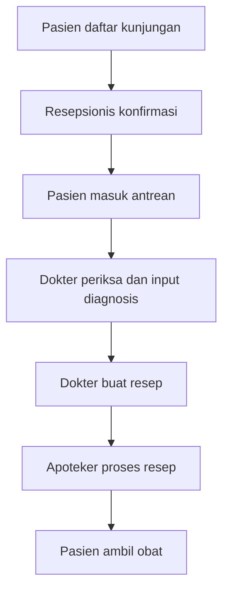
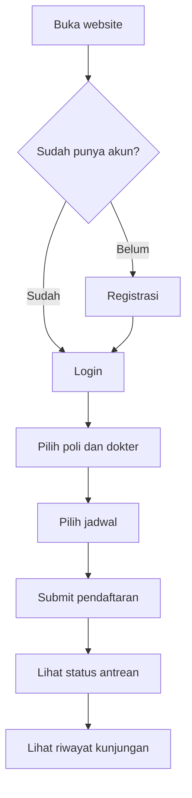
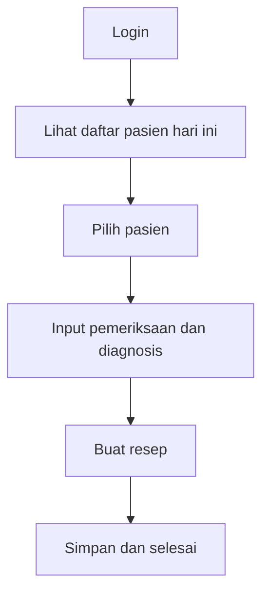
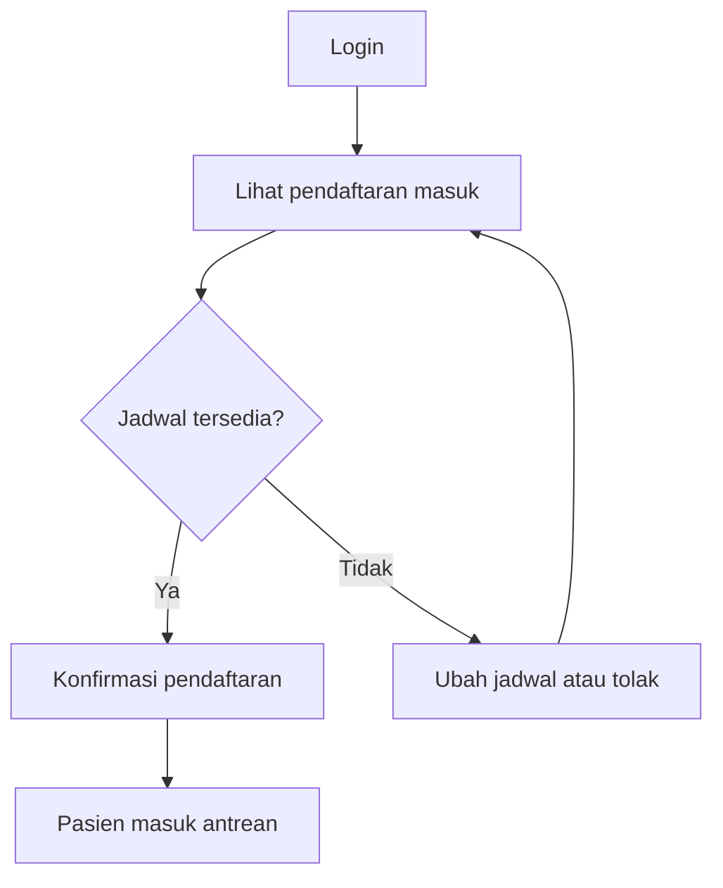
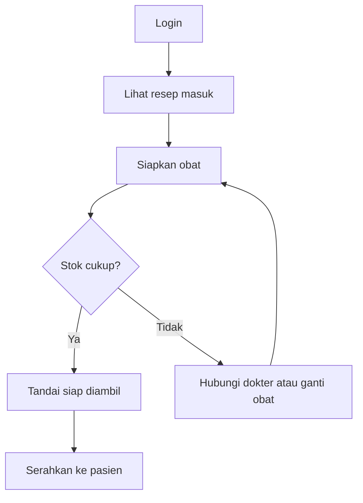

# PRD - Website Klinik

## 1. Scope

### 1.1 Tujuan
Website klinik untuk mengelola pendaftaran pasien, pemeriksaan dokter, dan pengambilan obat secara terintegrasi.

### 1.2 Pengguna
| Role | Deskripsi |
|------|-----------|
| Pasien | Mendaftar kunjungan, melihat jadwal dokter dan riwayat berobat |
| Dokter | Memeriksa pasien, mengisi diagnosis, membuat resep |
| Resepsionis | Mengelola pendaftaran, jadwal, dan antrean pasien |
| Apoteker | Memproses resep dan menyerahkan obat |

### 1.3 In Scope
**Pasien**
- Registrasi dan login
- Daftar kunjungan (pilih poli, dokter, jadwal)
- Lihat status antrean dan riwayat kunjungan

**Resepsionis**
- Konfirmasi atau ubah jadwal kunjungan
- Pendaftaran pasien walk-in
- Kelola antrean

**Dokter**
- Lihat daftar pasien hari ini
- Input hasil pemeriksaan dan diagnosis
- Buat resep obat

**Apoteker**
- Lihat resep masuk
- Update status resep (diproses, siap, diserahkan)
- Kelola stok obat dasar

### 1.4 Out of Scope
- Pembayaran online
- Integrasi BPJS/asuransi
- Telemedicine
- Aplikasi mobile native

### 1.5 Asumsi dan Batasan
- Satu klinik, satu cabang
- Pasien sudah punya akun sebelum daftar kunjungan
- (tambahkan sesuai kesepakatan tim)

---

## 2. Userflow

### 2.1 Alur Gabungan

### 2.2 Userflow Pasien

### 2.3 Userflow Dokter

### 2.4 Userflow Resepsionis

### 2.5 Userflow Apoteker

