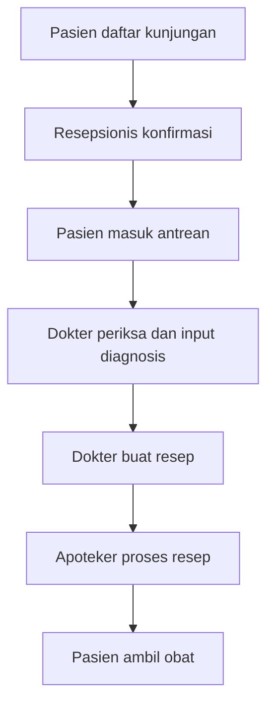
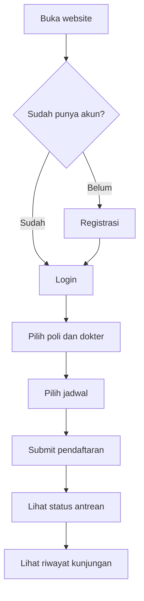
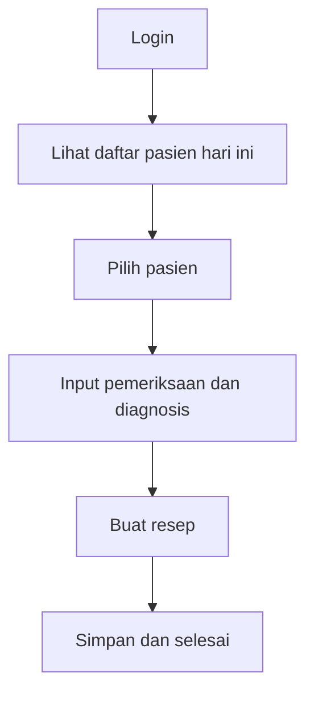
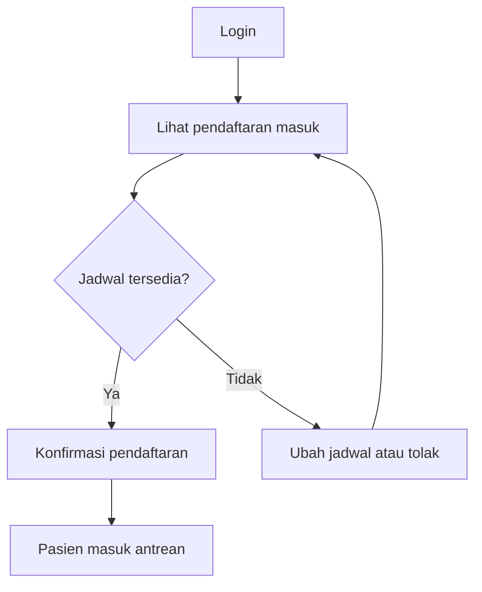
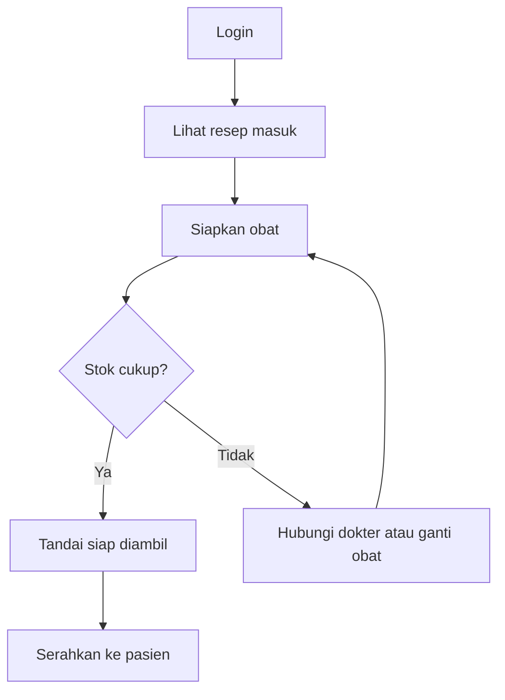

## 🛠️ Tech Stack Plan
Rencana teknologi dan *library* yang akan digunakan tim saat masuk ke tahap pengembangan (Modul 7):

* **Markup & Structure:** HTML5 (Semantic HTML)
* **Styling & Layout:** CSS3 / Tailwind CSS *(sesuaikan dengan kesepakatan tim, misal: Tailwind CSS v3.4 atau Vanilla CSS dengan CSS Variables)*
* **Interactivity & Component Behavior:** Vanilla JavaScript (ES6+) *(untuk navigasi antar-layar, modal konfirmasi, filter antrean, dan validasi form)*
* **Icons:** Lucide Icons / Heroicons *(sesuai aset ikon di wireframe Figma)*
* **Typography:** Google Fonts (`Plus Jakarta Sans` / `Inter`)
* **Version Control & Collaboration:** Git & GitHub (Branching workflow & Pull Request)
* **Deployment (Rencana):** Vercel / Netlify / GitHub Pages

---

## 🎨 Design Tokens (Panduan Gaya)
Standarisasi variabel visual dari desain Figma Modul 4 & 5 untuk konsistensi kode di Modul 7:

### 1. Color Palette (Palet Warna)
| Nama Token | Kode Hex | Penggunaan |
| :--- | :--- | :--- |
| `--color-primary` | `#0284C7` | Tombol utama (CTA), menu sidebar aktif, link utama |
| `--color-primary-hover` | `#0369A1` | State *hover* pada tombol utama |
| `--color-secondary` | `#0D9488` | Aksen sekunder, ikon medis, highlight status |
| `--color-bg-main` | `#FFFFFF` | Latar belakang utama card, modal, dan form input |
| `--color-bg-surface` | `#F8FAFC` | Latar belakang kanvas dashboard & section alternatif |
| `--color-text-primary` | `#0F172A` | Judul halaman, nama pasien/dokter, isi tabel |
| `--color-text-muted` | `#64748B` | Sub-judul, label input, keterangan waktu |
| `--color-border` | `#E2E8F0` | Garis tepi card, tabel, dan input field |
| `--color-success` | `#16A34A` | Badge status: *Selesai / Obat Siap / Tersedia* |
| `--color-warning` | `#D97706` | Badge status: *Menunggu Antrean / Sedang Diracik* |
| `--color-danger` | `#DC2626` | Tombol hapus/batal, peringatan stok obat habis |

### 2. Typography (Tipografi)
* **Font Family Utama:** `'Plus Jakarta Sans', sans-serif` *(ganti jika di Figma menggunakan Inter atau Poppins)*
* **Skala Ukuran Huruf:**
  * **H1 (Landing / Page Title):** `36px` / `2.25rem` — Bold (700), Line Height `1.2`
  * **H2 (Section / Dashboard Header):** `24px` / `1.5rem` — SemiBold (600), Line Height `1.3`
  * **H3 (Card / Modal Title):** `18px` / `1.125rem` — SemiBold (600), Line Height `1.4`
  * **Body Text (Tabel & Form):** `14px` – `16px` — Regular (400), Line Height `1.5`
  * **Badge / Caption:** `12px` / `0.75rem` — Medium (500)

### 3. Spacing, Border Radius & Elevation
* **Layout Structure:**
  * Public Landing Container: Max-width `1200px`
  * Dashboard Layout: Fixed Sidebar (`240px`) + Fluid Main Content Area
* **Border Radius:**
  * Button & Input Field: `8px`
  * Card & Tabel Container: `12px`
  * Status Badge (Pill): `9999px`
* **Box Shadow:** `0 2px 6px rgba(15, 23, 42, 0.06)`

---

## 🧩 Feature, Screen & Component Breakdown (Rincian Section Figma & Anotasi)
Pemetaan minimal **6 layar wireframe utama** beserta **perilaku tombol/komponen** dari Modul 4 & 5 untuk diimplementasikan di Modul 7:

### A. Global Reusable Components
* **Sidebar Navigation:** Menu navigasi kiri yang menyesuaikan *role* aktif, dilengkapi indikator *active state* dan tombol `Logout`.
* **Top Header Bar:** Menampilkan judul halaman aktif, *search bar* global, dan profil pengguna (*Nama & Role Badge*).
* **Data Table Component:** Tabel responsif dengan fitur pencarian/filter status dan *Status Badge* berwarna.

---

### B. Rincian Layar Wireframe & Perilaku Tombol (Component Annotations)

#### Layar 1: Landing Page / Beranda Klinik
* **Struktur Section:**
  1. **Navbar:** Logo Klinik, link navigasi (*Layanan, Jadwal Dokter, Kontak*), dan tombol `Masuk / Daftar`.
  2. **Hero Section:** Headline layanan klinik, sub-headline, tombol CTA `Daftar Berobat Sekarang`, dan ilustrasi klinik.
  3. **Jadwal Praktik Dokter Section:** Grid kartu berisi nama dokter, poli spesialis, dan jam praktik.
* **Perilaku Tombol (Anotasi):**
  * Klik `Masuk / Daftar` atau `Daftar Berobat Sekarang` → Mengarahkan pengguna ke **Layar 2 (Halaman Login / Pilih Role)**.

#### Layar 2: Login & Pemilihan Role (Auth Screen)
* **Struktur Section:**
  1. **Auth Card:** Form input `Email / Username`, `Password`, dan dropdown/tab pemilihan role (**Pasien, Resepsionis, Dokter, Apoteker**).
  2. **Link Registrasi:** Tautan untuk pasien baru membuat akun.
* **Perilaku Tombol (Anotasi):**
  * Klik `Masuk` → Validasi input tidak kosong, lalu mengarahkan ke dashboard sesuai *role* yang dipilih (**Layar 3, 4, 5, atau 6**).

#### Layar 3: Dashboard Pasien (`role: pasien`)
* **Struktur Section:**
  1. **Kartu Antrean Aktif:** Menampilkan nomor antrean saat ini, poli tujuan, dan estimasi waktu tunggu.
  2. **Form Booking Kunjungan:** Input pilih poli, pilih dokter, tanggal berobat, dan keluhan singkat.
  3. **Tabel Riwayat Kunjungan & Status Obat:** Daftar riwayat pemeriksaan sebelumnya beserta status resep di apotek.
* **Perilaku Tombol (Anotasi):**
  * Klik `Buat Janji / Ambil Antrean` → Memvalidasi form booking dan memunculkan nomor antrean baru pada **Kartu Antrean Aktif** dengan status `Menunggu`.
  * Klik `Lihat Detail Resep` → Membuka modal/pop-up rincian obat dan status pengambilan di apotek.

#### Layar 4: Dashboard Resepsionis (`role: resepsionis`)
* **Struktur Section:**
  1. **KPI Summary Cards:** 3 kartu statistik (*Total Pasien Hari Ini*, *Menunggu Verifikasi*, *Selesai*).
  2. **Action Bar & Filter:** Tombol `+ Tambah Pasien Walk-in`, kolom pencarian nama/NIK, dan filter status antrean.
  3. **Tabel Antrean Pendaftaran:** Kolom No. Antrean, Nama Pasien, Poli Tujuan, Status, dan Aksi.
* **Perilaku Tombol (Anotasi):**
  * Klik `+ Tambah Pasien Walk-in` → Membuka **Modal Form Pendaftaran Pasien** untuk mendaftarkan pasien langsung di tempat.
  * Klik `Verifikasi / Panggil` → Mengubah status antrean dari `Menunggu` menjadi `Siap Diperiksa` (meneruskan data pasien ke **Dashboard Dokter**).

#### Layar 5: Dashboard Dokter (`role: dokter`)
* **Struktur Section:**
  1. **Daftar Antrean Pasien Poli:** List pasien yang sudah diverifikasi oleh resepsionis.
  2. **Form Rekam Medis (EMR):** Input keluhan pasien, catatan pemeriksaan fisik, dan diagnosa.
  3. **Form Input E-Resep:** Input daftar obat (nama obat, jumlah, aturan pakai/dosis) dengan tombol tambah baris obat.
* **Perilaku Tombol (Anotasi):**
  * Klik `Periksa Pasien` pada daftar antrean → Memuat data identitas pasien terpilih ke dalam **Form Rekam Medis**.
  * Klik `+ Tambah Obat` → Menambahkan baris input obat baru pada form e-resep.
  * Klik `Simpan & Kirim Resep` → Menyimpan catatan diagnosa, mengubah status pasien menjadi `Selesai Diperiksa`, dan otomatis mengirim data resep ke **Dashboard Apoteker**.

#### Layar 6: Dashboard Apoteker (`role: apoteker`)
* **Struktur Section:**
  1. **Ringkasan Resep & Stok:** Kartu jumlah *Resep Masuk*, *Sedang Diracik*, dan *Peringatan Stok Menipis*.
  2. **Tabel Antrean E-Resep:** Daftar resep yang masuk dari dokter lengkap dengan nama pasien dan status obat.
  3. **Panel Detail Resep / Modal Racikan:** Rincian obat dan dosis yang harus disiapkan apoteker.
* **Perilaku Tombol (Anotasi):**
  * Klik `Lihat Resep` → Membuka panel/modal daftar obat yang diresepkan dokter untuk pasien tersebut.
  * Klik `Tandai Obat Siap` → Mengubah status resep dari `Sedang Disiapkan` menjadi `Siap Diambil` (memperbarui status di sisi **Dashboard Pasien**).
  * Klik `Serahkan Obat` → Menyelesaikan transaksi pengambilan obat (`Selesai`) dan mengurangi jumlah stok obat.

---

## 📱 Responsiveness Plan (Breakpoint)
* **Desktop (`> 1024px`):** Layout penuh dengan *Fixed Sidebar* di kiri dan tabel/form utama di kanan.
* **Tablet (`768px – 1024px`):** *Sidebar* dapat dilipat (*collapsible*), kartu statistik tersusun 2 kolom.
* **Mobile (`< 768px`):** Navigasi berubah menjadi *Hamburger Menu*, tabel data menggunakan *horizontal scroll* (`overflow-x: auto`), dan form menumpuk 1 kolom penuh.
=======
# PRD - Website Klinik

## 1. Scope

### 1.1 Tujuan
Website klinik untuk mengelola pendaftaran pasien, pemeriksaan dokter, dan pengambilan obat secara terintegrasi.

### 1.2 Pengguna
| Role | Deskripsi |
|------|-----------|
| Pasien | Mendaftar kunjungan, melihat jadwal dokter dan riwayat berobat |
| Dokter | Memeriksa pasien, mengisi diagnosis, membuat resep |
| Resepsionis | Mengelola pendaftaran, jadwal, dan antrean pasien |
| Apoteker | Memproses resep dan menyerahkan obat |

### 1.3 In Scope
**Pasien**
- Registrasi dan login
- Daftar kunjungan (pilih poli, dokter, jadwal)
- Lihat status antrean dan riwayat kunjungan

**Resepsionis**
- Konfirmasi atau ubah jadwal kunjungan
- Pendaftaran pasien walk-in
- Kelola antrean

**Dokter**
- Lihat daftar pasien hari ini
- Input hasil pemeriksaan dan diagnosis
- Buat resep obat

**Apoteker**
- Lihat resep masuk
- Update status resep (diproses, siap, diserahkan)
- Kelola stok obat dasar

### 1.4 Out of Scope
- Pembayaran online
- Integrasi BPJS/asuransi
- Telemedicine
- Aplikasi mobile native

### 1.5 Asumsi dan Batasan
- Satu klinik, satu cabang
- Pasien sudah punya akun sebelum daftar kunjungan
- (tambahkan sesuai kesepakatan tim)

---

## 2. Userflow

### 2.1 Alur Gabungan

### 2.2 Userflow Pasien

### 2.3 Userflow Dokter

### 2.4 Userflow Resepsionis

### 2.5 Userflow Apoteker

